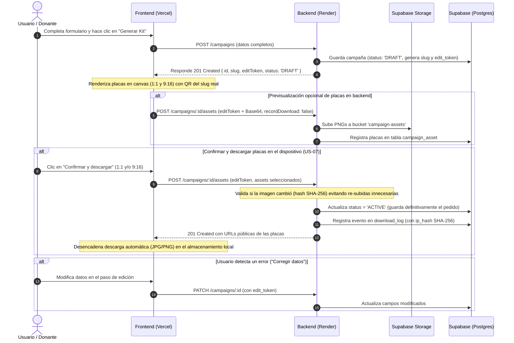
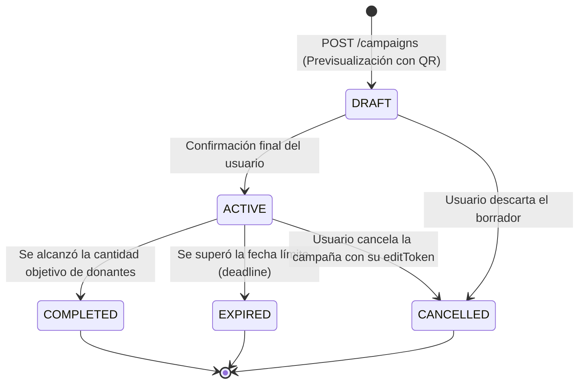

# 📖 Documentación Técnica de la API - DonaKit Backend

Servidor backend desarrollado con **NestJS**, **TypeScript**, **Prisma ORM** y **Supabase (PostgreSQL)** para la plataforma de donación de sangre y hemoderivados **DonaKit**.

---

## 🌐 1. Información General y Entornos

| Entorno | URL Base | Descripción |
| :--- | :--- | :--- |
| **Local (Desarrollo)** | `http://localhost:3000` | Entorno local por defecto (`PORT=3000`) |
| **Producción (Render)** | `https://donakit-backend.onrender.com` | Despliegue en la nube (rama `development`) |

### Convenciones Globales
* **Sin prefijo `/api`:** Todas las rutas responden directamente sobre la raíz (ej. `/campaigns`, `/institutions`, `/health`).
* **Formato de intercambio:** `application/json; charset=utf-8`.
* **Compatibilidad de Nombres de Campo (Input):** El backend cuenta con un middleware automático que acepta tanto `camelCase` como `snake_case` en los cuerpos de las peticiones (ej. `patientName` o `patient_name`).
* **CORS:**
  * Los orígenes permitidos se configuran exclusivamente mediante la variable de entorno `FRONTEND_URL` (lista separada por comas, ej. `https://donakit-frontend.vercel.app,http://localhost:3000,http://localhost:3001`), sin URLs hardcodeadas en el código fuente.
  * Si `FRONTEND_URL` incluye un dominio `https://<proyecto>.vercel.app`, el backend habilita automáticamente sus subdominios oficiales de preview en Vercel (`git-*` y hashes de despliegue).

---

## 🔄 2. Ciclo de Vida y Flujo de Integración (Frontend ⇄ Backend)

A partir de la versión actual, el flujo de creación de un kit de donación se basa en un estado inicial **`DRAFT`** para permitir previsualización con QR real antes de la publicación definitiva:



### Máquina de Estados de la Campaña (`campaign_status`)



---

## 🚪 3. Catálogo de Endpoints

### 3.1. Estado del Servidor y Base de Datos (`Health Check`)

Comprueba la operatividad del backend y la conectividad con la base de datos Supabase mediante un ping ligero (`SELECT 1`). No expone metadatos internos por seguridad.

* **Método:** `GET`
* **Ruta:** `/health`
* **Autenticación:** Pública

#### Respuestas:
* **`200 OK` (Operativo):**
  ```json
  {
    "status": "ok"
  }
  ```
* **`503 Service Unavailable` (Fallo de Base de Datos):**
  ```json
  {
    "statusCode": 503,
    "error": "Service Unavailable",
    "message": "Servicio no disponible"
  }
  ```

---

### 3.2. Listado de Instituciones para Combobox

Devuelve el catálogo de centros de salud e instituciones activas acotado a los campos necesarios para selectores en el frontend. Respuesta directa sin envoltorio para facilitar su consumo con librerías tipo Axios o Fetch.

* **Método:** `GET`
* **Ruta:** `/institutions`
* **Autenticación:** Pública
* **Ordenamiento:** Alfabético por `name` ascendente (`is_active = true`).

#### Respuesta `200 OK`:
```json
[
  {
    "id": "63a65bfe-3c92-484e-b658-d3446355e5c2",
    "name": "Hospital Garrahan - Hemoterapia",
    "address": "Combate de los Pozos 1881",
    "city": "CABA"
  },
  {
    "id": "a1b2c3d4-e5f6-4a1b-8c2d-3e4f5a6b7c8d",
    "name": "Hospital de Clínicas José de San Martín",
    "address": "Av. Córdoba 2351",
    "city": "CABA"
  }
]
```

---

### 3.2.1. Panel de Campañas Abiertas de la Institución (Dashboard) - US-20

Devuelve el listado de solicitudes y campañas de donación abiertas/activas para el panel de seguimiento de la institución administrativa. Incluye datos clave y el avance de donantes junto con el total acumulado de visitas (`totalVisits`).

Disponible tanto como sub-recurso de la institución como en la colección de campañas:
* **Rutas:**
  * `GET /institutions/:id/campaigns` *(recomendada para el panel institucional)*
  * `GET /campaigns?institutionId=...` *(o `GET /campaigns` para dashboard general)*
* **Query Params (opcionales):**
  * `status`: Filtra por estado (`ACTIVE`, `COMPLETED`, `EXPIRED`, `CANCELLED` o `ALL`). Por defecto: `ACTIVE`.
  * `institutionId`: (cuando se usa `/campaigns`) filtra por centro de salud.

#### Respuesta `200 OK`:
```json
{
  "success": true,
  "message": "Listado de campañas para panel administrativo obtenido exitosamente.",
  "total": 1,
  "data": [
    {
      "id": "b73a9e21-4f10-4821-bdfe-7bd73db49b06",
      "slug": "donantes-sofia-agustina-martinez-fefc4a",
      "patientName": "Sofía Agustina Martínez",
      "bloodType": "A+",
      "donationType": "Sangre entera",
      "status": "ACTIVE",
      "createdAt": "2026-10-28T19:40:00.000Z",
      "deadline": "2026-12-31T00:00:00.000Z",
      "targetDonors": 10,
      "currentDonors": 4,
      "progressPercentage": 40,
      "totalVisits": 85,
      "institution": {
        "id": "63a65bfe-3c92-484e-b658-d3446355e5c2",
        "name": "Hospital Garrahan - Hemoterapia",
        "city": "CABA"
      }
    }
  ]
}
```

---

### 3.2.2. Gestión Administrativa de Campañas por la Institución (Guardar / Sumar Donantes / Cerrar) - US-16, US-20

Permite al personal administrativo de la institución gestionar directamente las solicitudes de su centro de salud desde su panel: entrar a la campaña, aumentar o fijar la cantidad de donantes alcanzados (`currentDonors`), cambiar el estado para darla por cubierta/cerrada (`status = 'COMPLETED'`) o actualizar fechas y observaciones, y **guardar los cambios** sin necesidad del `editToken` familiar.

#### Reglas de Negocio para Cierre y Avance:
1. **Sin meta definida (`targetDonors = null` o vacío):** La campaña **nunca se cerrará automáticamente**, sin importar cuántos donantes se registren. Permanecerá abierta (`ACTIVE`) hasta que el administrador o la familia envíen explícitamente `status: "COMPLETED"` (o `"CANCELLED"`).
2. **Con meta definida (`targetDonors > 0`):** Si el administrador actualiza o incrementa la cantidad de donantes alcanzando o superando la meta requerida (`currentDonors >= targetDonors`) sin especificar un nuevo estado, el sistema **cambia automáticamente el estado a `"COMPLETED"`** y fija el avance en `progressPercentage: 100%`.

#### 1. Modificar y Guardar Cambios de la Campaña (`PATCH /institutions/:institutionId/campaigns/:campaignId`)

* **Método:** `PATCH`
* **Ruta:** `/institutions/:institutionId/campaigns/:campaignId`
* **Parámetros URL:**
  * `:institutionId` (UUID v4 obligatorio del centro de salud).
  * `:campaignId` (UUID v4 obligatorio de la campaña).
* **Headers requeridos:** `Content-Type: application/json`

#### Cuerpo de la Petición (`Request Body`):
```json
{
  "currentDonors": 10,
  "status": "COMPLETED",
  "observations": "Objetivo cubierto exitosamente."
}
```

*Ejemplo de suma incremental (+1 donante) y guardar:*
```json
{
  "incrementDonors": 1
}
```

#### Parámetros del Body:

| Campo | Tipo | Obligatorio | Descripción |
| :--- | :--- | :---: | :--- |
| `currentDonors` | `integer` | No | Fija el total acumulado de donantes que asistieron (0 a 1000). Recalcula automáticamente el `progressPercentage`. |
| `incrementDonors` | `integer` | No | Suma directamente la cantidad indicada al total de donantes actual (ej. `1` para registrar un nuevo donante que llegó al hospital). |
| `status` | `string` | No | Estado de la solicitud (`ACTIVE`, `COMPLETED`, `EXPIRED`, `CANCELLED`). Permite cerrar la campaña marcándola como `COMPLETED`. |
| `targetDonors` | `integer` / `null` | No | Permite ajustar la meta requerida de donantes si cambia el requerimiento clínico. |
| `deadline` | `string` / `null` | No | Prorroga o actualiza la fecha límite en formato ISO 8601 o `YYYY-MM-DD`. |
| `patientName` | `string` | No | Corrige el nombre del paciente (regenera el slug URL-friendly si cambia). |
| `bloodType` | `string` | No | Modifica o corrige el grupo sanguíneo requerido. |
| `donationType` | `string` / `null` | No | Modifica el tipo de donación (ej. "Plaquetas", "Sangre entera"). |
| `observations` | `string` / `null` | No | Instrucciones especiales actualizadas para los donantes. |

#### Respuesta `200 OK`:
```json
{
  "success": true,
  "message": "Campaña actualizada exitosamente por la institución.",
  "data": {
    "id": "b73a9e21-4f10-4821-bdfe-7bd73db49b06",
    "slug": "donantes-sofia-agustina-martinez-fefc4a",
    "patientName": "Sofía Agustina Martínez",
    "bloodType": "A+",
    "donationType": "Sangre entera",
    "targetDonors": 10,
    "currentDonors": 10,
    "progressPercentage": 100,
    "status": "COMPLETED",
    "deadline": "2026-12-31T00:00:00.000Z",
    "totalVisits": 85,
    "observations": "Objetivo cubierto exitosamente.",
    "institution": {
      "id": "63a65bfe-3c92-484e-b658-d3446355e5c2",
      "name": "Hospital Garrahan - Hemoterapia",
      "city": "CABA"
    }
  }
}
```

#### 2. Consultar Detalle Administrativo de una Campaña (`GET /institutions/:institutionId/campaigns/:campaignId`)

Devuelve el detalle integral de la campaña (incluyendo el contador acumulado de visitas `totalVisits`, requisitos y preguntas frecuentes) para cargar el formulario de edición o la ficha administrativa:

* **Método:** `GET`
* **Ruta:** `/institutions/:institutionId/campaigns/:campaignId`
* **Respuesta `200 OK`:** Misma estructura de `data` con la entidad completa de la campaña.

---

### 3.3. Crear Pedido de Donación (Generación de Kit / Borrador)

Crea el registro del pedido con estado **`DRAFT`**, genera un UUID único, un slug seguro para la URL amigable y un `editToken` para control de cambios posterior.

* **Método:** `POST`
* **Ruta:** `/campaigns`
* **Headers requeridos:** `Content-Type: application/json`
* **Autenticación:** Pública

#### Cuerpo de la Petición (`Request Body`):
```json
{
  "patientName": "Sofía Agustina Martínez",
  "institutionId": "63a65bfe-3c92-484e-b658-d3446355e5c2",
  "bloodType": "A+",
  "donationType": "Plaquetas",
  "targetDonors": 15,
  "deadline": "2026-12-31",
  "observations": "Presentarse con DNI en ayuno de grasas."
}
```

#### Parámetros del Body:

| Campo | Tipo | Obligatorio | Restricciones / Reglas |
| :--- | :--- | :---: | :--- |
| `patientName` | `string` | **Sí** | 2 a 255 caracteres. Solo letras, espacios, guiones o apóstrofes. No permite números. |
| `institutionId` | `string` (UUID v4) | **Sí** | Debe existir en la base de datos y tener `is_active: true`. |
| `bloodType` | `string` | **Sí** | Valores permitidos: `A+`, `A-`, `B+`, `B-`, `AB+`, `AB-`, `0+`, `0-`, `O+`, `O-`, `TODOS`. |
| `donationType` | `string` | No | Máx. 50 caracteres. Por defecto: `"Sangre entera"`. |
| `targetDonors` | `integer` | No | Número entero entre `1` y `1000`. |
| `deadline` | `string` | No | Formato de fecha ISO 8601 o `YYYY-MM-DD`. |
| `observations` | `string` | No | Texto libre de hasta 1000 caracteres. |

#### Respuesta `201 Created`:
```json
{
  "success": true,
  "message": "Pedido de donación creado exitosamente.",
  "data": {
    "id": "b73a9e21-4f10-4821-bdfe-7bd73db49b06",
    "slug": "donantes-sofia-agustina-martinez-fefc4a",
    "editToken": "8f3a9b1c-2e4d-4a1b-8c2d-3e4f5a6b7c8d",
    "institutionId": "63a65bfe-3c92-484e-b658-d3446355e5c2",
    "patientName": "Sofía Agustina Martínez",
    "bloodType": "A+",
    "donationType": "Plaquetas",
    "targetDonors": 15,
    "currentDonors": 0,
    "deadline": "2026-12-31T00:00:00.000Z",
    "observations": "Presentarse con DNI en ayuno de grasas.",
    "generatedCopy": null,
    "status": "DRAFT",
    "createdAt": "2026-10-28T19:40:00.000Z",
    "updatedAt": "2026-10-28T19:40:00.000Z",
    "institution": {
      "id": "63a65bfe-3c92-484e-b658-d3446355e5c2",
      "name": "Hospital Garrahan - Hemoterapia",
      "address": "Combate de los Pozos 1881",
      "city": "CABA"
    }
  }
}
```

#### Errores Comunes:
* **`400 Bad Request` (Error de validación de campos):**
  ```json
  {
    "statusCode": 400,
    "error": "Bad Request",
    "message": "Error de validación en los datos del formulario.",
    "errors": {
      "patientName": ["El nombre del paciente es requerido."],
      "institutionId": ["El centro de salud debe ser un UUID v4 válido."],
      "bloodType": ["El grupo sanguíneo debe ser uno de los formatos válidos..."]
    },
    "details": [...]
  }
  ```
* **`404 Not Found` (Institución inexistente o inactiva):**
  ```json
  {
    "statusCode": 404,
    "error": "Not Found",
    "message": "El centro de salud con ID '...' no fue encontrado o no está activo en el sistema."
  }
  ```

---

### 3.4. Consultar Pedido (por UUID o por Slug)

Permite visualizar la información de una campaña para los donantes que acceden a través del enlace compartido o escanean el código QR.

> 🔒 **Seguridad Garantizada:** Por defecto, **esta respuesta no expone `editToken` ni `slug`**. El enlace ya contiene el slug y el token solo le pertenece al creador original.
>
> ✏️ **Modo Edición Opcional (US-09):** Si se añade el parámetro query `?editToken=<token>`, el endpoint valida la autenticidad del token y devuelve la entidad completa con `editToken` y `slug` para precargar el formulario de edición. Si el token es inválido, devuelve `403 Forbidden`.

* **Método:** `GET`
* **Ruta:** `/campaigns/:idOrSlug`
* **Parámetro URL:** `:idOrSlug` (acepta tanto el UUID v4 como el slug amigable, ej. `donantes-sofia-agustina-martinez-fefc4a`).
* **Query Params (opcional):** `?editToken=...` (para consultar en modo edición).
* **Autenticación:** Pública (o restringida con `editToken` en modo edición).

#### Respuesta `200 OK` (Vista Pública Landing Page):
```json
{
  "success": true,
  "message": "Pedido de donación obtenido exitosamente.",
  "data": {
    "id": "b73a9e21-4f10-4821-bdfe-7bd73db49b06",
    "institutionId": "63a65bfe-3c92-484e-b658-d3446355e5c2",
    "patientName": "Sofía Agustina Martínez",
    "bloodType": "0+",
    "donationType": "Sangre entera",
    "targetDonors": 10,
    "currentDonors": 0,
    "deadline": "2026-11-20T00:00:00.000Z",
    "observations": "Presentarse con DNI en el centro de hemoterapia en ayunas de lácteos y grasas.",
    "generatedCopy": "¡Se necesitan 10 donantes de sangre 0+ para Sofía Martínez!",
    "status": "ACTIVE",
    "createdAt": "2026-10-28T19:40:00.000Z",
    "updatedAt": "2026-10-28T19:40:00.000Z",
    "institution": {
      "id": "63a65bfe-3c92-484e-b658-d3446355e5c2",
      "name": "Hospital Garrahan - Hemoterapia",
      "address": "Combate de los Pozos 1881",
      "city": "CABA",
      "phone": "011 4122-6000",
      "whatsapp": "+5491120270742",
      "email": "hemoterapia@garrahan.gov.ar",
      "websiteUrl": "https://www.garrahan.gov.ar",
      "requirementsUrl": "https://www.garrahan.gov.ar/donar-sangre",
      "faqUrl": "https://www.garrahan.gov.ar/preguntas-frecuentes-donacion",
      "businessHours": {
        "dias": "Lunes a Viernes",
        "horario": "07:00 a 18:00",
        "sabados": "07:00 a 12:00"
      },
      "specificRequirements": "Solicitar turno previo en el portal o vía WhatsApp para evitar demoras.",
      "logoUrl": null
    },
    "requirements": [
      {
        "id": "73e82cbd-11c5-4533-b025-15ea2f977f60",
        "institutionId": null,
        "title": "Edad",
        "description": "Tener entre 16 y 65 años (menores de 18 con autorización de padres o tutores).",
        "isImmediateDisqualification": true,
        "category": "GENERAL",
        "displayOrder": 1
      },
      {
        "id": "0e2f5ce8-7532-49f5-9cfb-7251b81a1e60",
        "institutionId": null,
        "title": "Peso",
        "description": "Pesar más de 50 kg.",
        "isImmediateDisqualification": true,
        "category": "GENERAL",
        "displayOrder": 2
      },
      {
        "id": "fbe40ae4-1bf0-40d6-a690-bdd753ad6287",
        "institutionId": null,
        "title": "Desayuno/Comida previa",
        "description": "No estar en ayunas total: desayunar té, café, mate o jugo con azúcar y frutas. Evitar grasas y lácteos.",
        "isImmediateDisqualification": false,
        "category": "HABITOS",
        "displayOrder": 3
      }
    ],
    "faqs": [
      {
        "id": "b95e8df4-aba5-49dd-a38a-c6bf22269858",
        "institutionId": null,
        "question": "¿Puedo donar si tengo tatuajes o piercings?",
        "answer": "Sí, siempre y cuando hayan transcurrido 6 meses desde que te los hiciste.",
        "category": "TATUAJES",
        "displayOrder": 1
      },
      {
        "id": "5d025991-d891-4020-bb8c-8be0aa78eb2c",
        "institutionId": null,
        "question": "¿Puedo donar si tomo medicación diaria?",
        "answer": "La mayoría de medicamentos comunes son compatibles. Consulta en el centro con el nombre del fármaco.",
        "category": "MEDICACION",
        "displayOrder": 2
      },
      {
        "id": "edabeef3-551b-4dc3-b0a0-b27e8e6afca8",
        "institutionId": null,
        "question": "¿Puedo donar si tuve Hepatitis?",
        "answer": "Si tuviste Hepatitis A antes de los 10 u 11 años, puedes donar. Hepatitis B o C inhabilitan de forma permanente.",
        "category": "HEPATITIS",
        "displayOrder": 3
      }
    ],
    "assets": []
  }
}
```

---

### 3.4.1. Consultar Requisitos de la Campaña (`GET /campaigns/:idOrSlug/requirements`) - US-12

Permite consultar específicamente el listado de requisitos aplicables a la institución de la campaña.

* **Método:** `GET`
* **Ruta:** `/campaigns/:idOrSlug/requirements`
* **Query Params (opcionales):**
  - `category`: Filtra por categoría (`GENERAL`, `HABITOS`, `SALUD`).
  - `immediateOnly`: Si es `true`, devuelve únicamente las inhabilitaciones inmediatas (ej. edad, peso, cirugías recientes).

#### Respuesta `200 OK`:
```json
{
  "success": true,
  "message": "Requisitos de donación obtenidos exitosamente.",
  "data": [
    {
      "id": "73e82cbd-11c5-4533-b025-15ea2f977f60",
      "institutionId": null,
      "title": "Edad",
      "description": "Tener entre 16 y 65 años.",
      "isImmediateDisqualification": true,
      "category": "GENERAL",
      "displayOrder": 1
    }
  ]
}
```

---

### 3.4.2. Consultar Preguntas Frecuentes de la Campaña (`GET /campaigns/:idOrSlug/faqs`) - US-13

Permite consultar las preguntas frecuentes y condiciones médicas asociadas a la campaña.

* **Método:** `GET`
* **Ruta:** `/campaigns/:idOrSlug/faqs`
* **Query Params (opcionales):**
  - `category`: Filtra por categoría médica (`TATUAJES`, `MEDICACION`, `HEPATITIS`, `INTERVENCIONES`, `ESTILO_DE_VIDA`).

#### Respuesta `200 OK`:
```json
{
  "success": true,
  "message": "Preguntas frecuentes obtenidas exitosamente.",
  "data": [
    {
      "id": "b95e8df4-aba5-49dd-a38a-c6bf22269858",
      "institutionId": null,
      "question": "¿Puedo donar si tengo tatuajes o piercings?",
      "answer": "Sí, habiendo pasado 6 meses.",
      "category": "TATUAJES",
      "displayOrder": 1
    }
  ]
}
```

---

### 3.4.3. Endpoints Globales de Información (Menú Principal de la Plataforma)

* **`GET /faqs`:** Lista las preguntas frecuentes globales del sistema. Acepta query params `?category=...` e `?institutionId=...`.
* **`GET /requirements`:** Lista los requisitos generales de donación del sistema. Acepta query params `?category=...`, `?immediateOnly=true` e `?institutionId=...`.

#### Errores Comunes:
* **`404 Not Found` (Campaña inexistente):**
  ```json
  {
    "statusCode": 404,
    "error": "Not Found",
    "message": "No se encontró el pedido de donación con ID o slug '...'."
  }
  ```

---

### 3.4.4. Registro y Contador de Visitas a la Landing Page - US-19

Permite registrar y monitorear el alcance de visitas de un pedido de donación tanto por clic directo como por escaneo del código QR.

#### Reglas de Privacidad y Trazabilidad:
1. **Registro Automático e Invisible:** Al consultar `GET /campaigns/:idOrSlug` sin `editToken`, el backend registra automáticamente la visita en `campaign_metric` (tipo de dispositivo, referrer y hash SHA-256 anónimo de la IP).
2. **Protección de Datos:** La respuesta pública de `GET /campaigns/:idOrSlug` **no expone** el campo `totalVisits` para proteger la privacidad del paciente y la campaña ante potenciales donantes anónimos.
3. **Consulta Segura de Métricas:** Solo usuarios autorizados (con `editToken`) o el panel administrativo pueden consultar las métricas acumuladas.

#### Endpoint 1: Consultar Contador de Visitas (`GET /campaigns/:idOrSlug/metrics`)
* **Método:** `GET`
* **Ruta:** `/campaigns/:idOrSlug/metrics`
* **Query Params:**
  * `editToken` (**obligatorio**): Token secreto de edición asignado a la campaña.
* **Respuesta `200 OK`:**
  ```json
  {
    "success": true,
    "message": "Métricas de campaña obtenidas exitosamente.",
    "data": {
      "campaignId": "b73a9e21-4f10-4821-bdfe-7bd73db49b06",
      "totalVisits": 142
    }
  }
  ```
* **Respuesta `403 Forbidden` (Token ausente o inválido):**
  ```json
  {
    "statusCode": 403,
    "error": "Forbidden",
    "message": "El editToken es requerido y debe ser válido para consultar las métricas de la campaña."
  }
  ```

#### Endpoint 2: Registro Explícito de Visita (`POST /campaigns/:idOrSlug/visit`)
Permite al frontend reportar explícitamente el evento de visita al montar la vista de la landing si así lo prefiere.
* **Método:** `POST`
* **Ruta:** `/campaigns/:idOrSlug/visit`
* **Body (opcional):**
  ```json
  {
    "referrer": "QR"
  }
  ```
* **Respuesta `200 OK`:**
  ```json
  {
    "success": true,
    "message": "Visita registrada exitosamente."
  }
  ```

---

### 3.5. Registrar, Confirmar y Descargar Placas Gráficas Generadas (`POST /campaigns/:id/assets`) - US-07

Permite al frontend (que genera las placas en canvas de alta fidelidad) registrar y almacenar las imágenes en el bucket de **Supabase Storage** (`campaign-assets`) y registrar los metadatos correspondientes en la tabla **`campaign_asset`**.

Además, este endpoint cumple las reglas de negocio de la historia de usuario **US-07**:
1. **Deduplicación inteligente (Control de cambios):** Compara el contenido de la imagen recibida contra el archivo existente en Supabase Storage mediante un hash criptográfico **SHA-256** (`isSameFile`). Si la placa es idéntica a la ya existente, se reutiliza el asset sin re-subir bytes duplicados.
2. **Carga opcional de Base64:** Si una placa ya fue almacenada durante la previsualización, el difusor puede confirmar y descargar enviando únicamente el formato (ej. `{ "format": "SQUARE_1_1" }`) sin tener que reenviar el string Base64.
3. **Guardado definitivo de la campaña:** Si el pedido se encuentra en estado borrador (`DRAFT`), se actualiza automáticamente a estado activo (`ACTIVE`), consolidando la publicación de la campaña en la plataforma.
4. **Registro de auditoría y métricas de descarga:** Cada placa descargada/confirmada crea una fila en la tabla **`download_log`** (`IMAGE_1_1` o `IMAGE_9_16`), almacenando la fecha y el hash SHA-256 de la dirección IP (`ip_hash`) para preservar la privacidad de los usuarios. Puede deshabilitarse enviando `"recordDownload": false` en peticiones internas de previsualización.

* **Método:** `POST`
* **Ruta:** `/campaigns/:id/assets`
* **Parámetro URL:** `:id` (UUID v4 obligatorio del pedido de donación).
* **Headers requeridos:** `Content-Type: application/json`
* **Autenticación / Autorización:** Requiere enviar el campo `editToken` para verificar que la petición sea emitida por quien generó el borrador.

#### Cuerpo de la Petición (`Request Body`):
```json
{
  "editToken": "8f3a9b1c-2e4d-4a1b-8c2d-3e4f5a6b7c8d",
  "recordDownload": true,
  "assets": [
    {
      "format": "SQUARE_1_1",
      "imageBase64": "data:image/png;base64,iVBORw0KGgoAAAANSUhEUgAA...",
      "width": 1080,
      "height": 1080
    },
    {
      "format": "STORY_9_16",
      "imageBase64": "data:image/png;base64,iVBORw0KGgoAAAANSUhEUgAA...",
      "width": 1080,
      "height": 1920
    }
  ]
}
```

*Ejemplo de confirmación sin reenviar Base64 (si la placa ya fue cargada en previsualización):*
```json
{
  "editToken": "8f3a9b1c-2e4d-4a1b-8c2d-3e4f5a6b7c8d",
  "assets": [
    {
      "format": "SQUARE_1_1"
    }
  ]
}
```

#### Parámetros del Body:

| Campo | Tipo | Obligatorio | Descripción y Reglas |
| :--- | :--- | :---: | :--- |
| `editToken` | `string` | **Sí** | Token secreto de edición asignado al crear el pedido. Acepta también `edit_token`. |
| `generatedCopy` | `string` | No | Texto publicitario (copy) actualizado para compartir en redes. Acepta `generated_copy`. |
| `recordDownload` | `boolean` | No | Determina si se registra el evento en `download_log`. Por defecto `true`. Acepta también `record_download`. |
| `downloadType` | `string` | No | Tipo de descarga específico (`IMAGE_1_1`, `IMAGE_9_16`, `PDF_KIT` o `ZIP_BUNDLE`). Acepta `download_type`. Si se envía `ZIP_BUNDLE`, se registra una única descarga de tipo ZIP_BUNDLE en lugar de registrar individualmente cada placa. |
| `assets` | `array` | **Sí** | Colección de placas generadas (mínimo 1 elemento). Puede contener una sola placa o ambas. |
| `assets[].format` | `string` | **Sí** | Formato de la placa: `SQUARE_1_1` (feed) o `STORY_9_16` (historia). |
| `assets[].imageBase64` | `string` | Condicional | Imagen en Base64 (Data URL o Base64 puro). **Obligatoria solo si la placa no fue creada previamente en previsualización**. Acepta también `image_base64`. |
| `assets[].width` | `integer` | No | Ancho en píxeles (por defecto `1080`). Mínimo `100`. |
| `assets[].height` | `integer` | No | Alto en píxeles (por defecto `1080` para 1:1 y `1920` para 9:16). Mínimo `100`. |

#### Respuesta `201 Created`:
```json
{
  "success": true,
  "message": "Placas del pedido registradas y almacenadas exitosamente.",
  "data": [
    {
      "id": "11a2b3c4-5d6e-7f8a-9b0c-1d2e3f4a5b6c",
      "campaignId": "b73a9e21-4f10-4821-bdfe-7bd73db49b06",
      "format": "SQUARE_1_1",
      "imageUrl": "https://xyz.supabase.co/storage/v1/object/public/campaign-assets/b73a9e21-4f10-4821-bdfe-7bd73db49b06/square_1_1.png",
      "width": 1080,
      "height": 1080,
      "createdAt": "2026-10-30T10:45:00.000Z"
    },
    {
      "id": "22a2b3c4-5d6e-7f8a-9b0c-1d2e3f4a5b6c",
      "campaignId": "b73a9e21-4f10-4821-bdfe-7bd73db49b06",
      "format": "STORY_9_16",
      "imageUrl": "https://xyz.supabase.co/storage/v1/object/public/campaign-assets/b73a9e21-4f10-4821-bdfe-7bd73db49b06/story_9_16.png",
      "width": 1080,
      "height": 1920,
      "createdAt": "2026-10-30T10:45:00.000Z"
    }
  ]
}
```

#### Errores Comunes:
* **`400 Bad Request`:** Formato de UUID inválido en `:id`, Base64 corrupto, tipo de archivo no admitido, lista de assets vacía o solicitud de placa sin Base64 cuando no existía previamente.
* **`403 Forbidden`:** El `editToken` enviado no coincide con el token del creador de la campaña.
* **`404 Not Found`:** No existe una campaña con el UUID indicado.

---

### 3.6. Corregir / Modificar Datos del Pedido (`PATCH /campaigns/:id`) - US-09

Permite al difusor corregir o modificar los datos del formulario antes de generar la versión final de las placas o después de haber visualizado el borrador.

* **Regeneración Automática de Slug:** Si el nombre del paciente (`patientName`) es modificado, el sistema regenera un nuevo slug URL-friendly para mantener la consistencia con el código QR y enlaces compartidos.
* **Autorización:** Requiere enviar el `editToken` original en el cuerpo de la petición.
* **Actualización Parcial y Limpieza:** Solo se actualizan los campos presentes en el cuerpo de la petición. Los campos opcionales (`targetDonors`, `deadline`, `observations`, `donationType`) admiten `null` o `""` (string vacío) para borrar su valor en base de datos (`NULL`). Si un campo se omite de la petición (`undefined`), conserva su valor actual sin modificaciones.

* **Método:** `PATCH`
* **Ruta:** `/campaigns/:id`
* **Parámetro URL:** `:id` (UUID v4 obligatorio del pedido de donación).
* **Headers requeridos:** `Content-Type: application/json`
* **Autenticación / Autorización:** Requiere `editToken`.

#### Cuerpo de la Petición (`Request Body`):
```json
{
  "editToken": "8f3a9b1c-2e4d-4a1b-8c2d-3e4f5a6b7c8d",
  "patientName": "Sofía A. Martínez",
  "bloodType": "0+",
  "donationType": "Sangre entera",
  "targetDonors": 20,
  "deadline": "2026-12-15",
  "observations": "Corregido: concurrir en ayunas de sólidos 4 hs."
}
```

#### Parámetros del Body:

| Campo | Tipo | Obligatorio | Descripción |
| :--- | :--- | :---: | :--- |
| `editToken` | `string` | **Sí** | Token secreto de edición asignado al crear el pedido. Acepta también `edit_token`. |
| `patientName` | `string` | No | Nombre del paciente receptor (2-255 caracteres, sin números). Acepta `patient_name`. Si cambia, se regenera el slug. |
| `institutionId` | `string` (UUID v4) | No | Nuevo centro de salud activo. Acepta `institution_id`. |
| `bloodType` | `string` | No | Grupo sanguíneo (`A+`, `A-`, `B+`, `B-`, `AB+`, `AB-`, `0+`, `0-`, `O+`, `O-`, `TODOS`). Acepta `blood_type`. |
| `donationType` | `string` / `null` | No | Tipo de extracción. Acepta `donation_type`. Enviar `null` o `""` borra el valor en BD. |
| `targetDonors` | `integer` / `null` | No | Cantidad requerida de donantes (1 a 1000). Acepta `target_donors`. Enviar `null` o `""` borra el valor en BD. |
| `deadline` | `string` / `null` | No | Fecha límite en formato ISO 8601 o `YYYY-MM-DD`. Enviar `null` o `""` borra el valor en BD. |
| `observations` | `string` / `null` | No | Indicaciones adicionales para donantes (máx. 1000 caracteres). Enviar `null` o `""` borra el valor en BD. |
| `generatedCopy` | `string` / `null` | No | Texto publicitario (copy) actualizado para compartir en redes. Acepta `generated_copy`. Enviar `null` o `""` borra el valor en BD. |
| `status` | `string` | No | Estado de la campaña (`ACTIVE`, `COMPLETED`, `EXPIRED`, `CANCELLED`). Permite marcar como cubierto (`COMPLETED`) (US-16). |
| `currentDonors` | `integer` | No | Donantes conseguidos hasta la fecha (0 a 1000). Acepta `current_donors` (US-16, US-20). |

#### Respuesta `200 OK`:
```json
{
  "success": true,
  "message": "Pedido de donación actualizado exitosamente.",
  "data": {
    "id": "b73a9e21-4f10-4821-bdfe-7bd73db49b06",
    "slug": "donantes-sofia-a-martinez-84e1b2",
    "editToken": "8f3a9b1c-2e4d-4a1b-8c2d-3e4f5a6b7c8d",
    "patientName": "Sofía A. Martínez",
    "bloodType": "0+",
    "donationType": "Sangre entera",
    "targetDonors": 20,
    "currentDonors": 0,
    "deadline": "2026-12-15T00:00:00.000Z",
    "observations": "Corregido: concurrir en ayunas de sólidos 4 hs.",
    "status": "DRAFT",
    "createdAt": "2026-10-28T19:40:00.000Z",
    "updatedAt": "2026-11-06T12:00:00.000Z",
    "institution": {
      "id": "63a65bfe-3c92-484e-b658-d3446355e5c2",
      "name": "Hospital Garrahan - Hemoterapia",
      "address": "Combate de los Pozos 1881",
      "city": "CABA"
    }
  }
}
```

#### Errores Comunes:
* **`400 Bad Request`:** `editToken` faltante, campos con formato inválido (ej. números en nombre del paciente o grupo inválido) o intento de modificar una campaña cancelada.
* **`403 Forbidden`:** El `editToken` enviado no coincide con el token del creador de la campaña.
* **`404 Not Found`:** No existe una campaña con el UUID indicado o el nuevo `institutionId` no existe.

---

### 3.7. Validar Token de Edición (`POST /campaigns/:id/verify-token`) - US-09

Permite al frontend verificar si un token de edición almacenado en el cliente (localStorage, session o URL) es válido para la campaña indicada y obtener los datos completos del pedido para precargar el formulario sin exponer el token en llamadas GET públicas.

* **Método:** `POST`
* **Ruta:** `/campaigns/:id/verify-token`
* **Parámetro URL:** `:id` (UUID v4 obligatorio del pedido de donación).
* **Headers requeridos:** `Content-Type: application/json`

#### Cuerpo de la Petición (`Request Body`):
```json
{
  "editToken": "8f3a9b1c-2e4d-4a1b-8c2d-3e4f5a6b7c8d"
}
```

#### Respuesta `200 OK`:
```json
{
  "success": true,
  "message": "Token de edición validado exitosamente.",
  "data": {
    "id": "b73a9e21-4f10-4821-bdfe-7bd73db49b06",
    "slug": "donantes-sofia-agustina-martinez-fefc4a",
    "editToken": "8f3a9b1c-2e4d-4a1b-8c2d-3e4f5a6b7c8d",
    "patientName": "Sofía Agustina Martínez",
    "bloodType": "A+",
    "donationType": "Plaquetas",
    "targetDonors": 15,
    "currentDonors": 0,
    "deadline": "2026-12-31T00:00:00.000Z",
    "observations": "Presentarse con DNI en ayuno de grasas.",
    "status": "DRAFT",
    "createdAt": "2026-10-28T19:40:00.000Z",
    "updatedAt": "2026-10-28T19:40:00.000Z",
    "institution": {
      "id": "63a65bfe-3c92-484e-b658-d3446355e5c2",
      "name": "Hospital Garrahan - Hemoterapia",
      "address": "Combate de los Pozos 1881",
      "city": "CABA"
    }
  }
}
```

#### Errores Comunes:
* **`400 Bad Request`:** UUID v4 inválido o campo `editToken` ausente.
* **`403 Forbidden`:** El `editToken` no coincide con el registrado para la campaña.
* **`404 Not Found`:** No existe una campaña con el UUID indicado.

---

## 🗄️ 4. Diccionario de Datos (Data Dictionary)

### 4.1. Tabla: `campaign` (Campañas / Pedidos de Donación)

| Columna | Tipo en BD | Nulo | Por Defecto | Descripción y Reglas de Negocio |
| :--- | :--- | :---: | :--- | :--- |
| `id` | `UUID` | No | `uuid_generate_v4()` | Identificador único primario de la campaña. |
| `slug` | `VARCHAR(100)` | No | - | Slug único URL-friendly (`donantes-[nombre]-[hash]`). Con índice único. |
| `edit_token` | `VARCHAR(100)` | No | - | Token secreto para autorizar ediciones o confirmaciones futuras. |
| `institution_id` | `UUID` | No | - | Clave foránea que referencia a `institution(id)`. |
| `patient_name` | `VARCHAR(255)` | No | - | Nombre completo del paciente receptor. |
| `blood_type` | `VARCHAR(10)` | No | - | Grupo sanguíneo (`A+`, `0-`, `TODOS`, etc.). |
| `donation_type` | `VARCHAR(50)` | Sí | `'Sangre entera'` | Tipo de extracción requerida. |
| `target_donors` | `INTEGER` | Sí | `null` | Cantidad estimada de donantes que se necesitan. |
| `current_donors` | `INTEGER` | Sí | `0` | Cantidad de donantes confirmados. |
| `deadline` | `DATE` | Sí | `null` | Fecha límite para recibir las donaciones. |
| `observations` | `TEXT` | Sí | `null` | Indicaciones especiales (horarios, sala, ayuno, etc.). |
| `generated_copy`| `TEXT` | Sí | `null` | Texto publicitario generado automáticamente para redes. |
| `status` | `campaign_status`| No | `'DRAFT'` | Estado actual de la campaña. |
| `created_at` | `TIMESTAMPTZ(6)`| No | `now()` | Fecha y hora UTC de creación. |
| `updated_at` | `TIMESTAMPTZ(6)`| No | `now()` | Fecha y hora UTC de la última actualización. |

---

### 4.2. Tabla: `institution` (Centros de Salud / Hospitales)

| Columna | Tipo en BD | Nulo | Por Defecto | Descripción |
| :--- | :--- | :---: | :--- | :--- |
| `id` | `UUID` | No | `uuid_generate_v4()` | Identificador único de la institución. |
| `name` | `VARCHAR(255)` | No | - | Nombre oficial del centro o servicio de hemoterapia. |
| `address` | `VARCHAR(255)` | No | - | Dirección física (calle y numeración). |
| `city` | `VARCHAR(100)` | No | `'Buenos Aires'` | Ciudad o localidad. |
| `phone` | `VARCHAR(50)` | Sí | `null` | Teléfono de contacto institucional. |
| `whatsapp` | `VARCHAR(50)` | Sí | `null` | Número de WhatsApp para consultas. |
| `email` | `VARCHAR(100)` | Sí | `null` | Correo electrónico de contacto. |
| `website_url` | `TEXT` | Sí | `null` | Sitio web oficial. |
| `requirements_url`| `TEXT` | Sí | `null` | Enlace a requisitos específicos de la institución. |
| `faq_url` | `TEXT` | Sí | `null` | Enlace a preguntas frecuentes. |
| `business_hours`| `JSON` | Sí | *(Lunes a Viernes 8 a 12)* | Días y franjas horarias de atención. |
| `specific_requirements` | `TEXT` | Sí | `null` | Condiciones particulares exigidas por el centro. |
| `logo_url` | `TEXT` | Sí | `null` | URL de la imagen del logotipo. |
| `is_active` | `BOOLEAN` | No | `true` | Determina si se ofrece en los selectores del frontend. |
| `created_at` | `TIMESTAMPTZ(6)`| No | `now()` | Fecha de alta en el sistema. |

---

### 4.3. Tabla: `campaign_asset` (Placas Gráficas Almacenadas)

| Columna | Tipo en BD | Nulo | Por Defecto | Descripción |
| :--- | :--- | :---: | :--- | :--- |
| `id` | `UUID` | No | `uuid_generate_v4()` | Identificador único del asset. |
| `campaign_id` | `UUID` | No | - | Referencia foránea a la campaña (`ON DELETE CASCADE`). |
| `format` | `asset_format` | No | - | Formato de la placa (`SQUARE_1_1` o `STORY_9_16`). |
| `image_url` | `TEXT` | No | - | URL pública en Supabase Storage (`campaign-assets`). |
| `width` | `INTEGER` | No | - | Ancho en píxeles (ej. 1080). |
| `height` | `INTEGER` | No | - | Alto en píxeles (ej. 1080 o 1920). |
| `created_at` | `TIMESTAMPTZ(6)` | No | `now()` | Fecha y hora UTC del registro. |

---

### 4.4. Tabla: `download_log` (Auditoría de Descargas - US-07)

| Columna | Tipo en BD | Nulo | Por Defecto | Descripción |
| :--- | :--- | :---: | :--- | :--- |
| `id` | `UUID` | No | `uuid_generate_v4()` | Identificador único del evento de descarga. |
| `campaign_id` | `UUID` | No | - | Referencia foránea a la campaña (`ON DELETE CASCADE`). |
| `download_type`| `download_type`| No | - | Tipo descargado (`IMAGE_1_1`, `IMAGE_9_16`, `ZIP_BUNDLE`). |
| `downloaded_at`| `TIMESTAMPTZ(6)`| No | `now()` | Fecha y hora UTC de la descarga. |
| `ip_hash` | `VARCHAR(64)` | Sí | `null` | Hash SHA-256 de la IP del cliente (anonimización por privacidad). |

---

### 4.5. Enumeraciones del Sistema (Enums)

#### `campaign_status`
* **`DRAFT`:** Pedido creado durante el paso de previsualización con QR generado. Pendiente de confirmación.
* **`ACTIVE`:** Campaña confirmada y activa públicamente para recibir donaciones.
* **`COMPLETED`:** Campaña finalizada con éxito al alcanzar los donantes necesarios.
* **`EXPIRED`:** Campaña vencida tras superar la fecha límite (`deadline`).
* **`CANCELLED`:** Campaña cancelada por el usuario o administradores.

#### `asset_format`
* **`SQUARE_1_1`:** Plantilla gráfica cuadrada para feed de Instagram/Facebook (1080x1080).
* **`STORY_9_16`:** Plantilla gráfica vertical para Stories de Instagram/WhatsApp (1080x1920).

#### `download_type`
* **`IMAGE_1_1`:** Descarga individual de imagen cuadrada.
* **`IMAGE_9_16`:** Descarga individual de imagen vertical.
* **`ZIP_BUNDLE`:** Descarga del paquete completo comprimido.

---

## 🛠️ 5. Tablas de Soporte y Métricas

* **`campaign_asset`:** Almacena las URLs y dimensiones de las imágenes finales generadas para cada campaña.
* **`campaign_metric`:** Registra visitas anónimas por campaña con tipo de dispositivo, referrer y hash criptográfico de IP (sin almacenar la IP real por privacidad).
* **`download_log`:** Auditoría de descargas de kits para métricas de alcance.
* **`requirement`:** Requisitos generales y específicos por centro de salud (ej. peso mínimo, edad, tatuajes).
* **`faq_item`:** Preguntas y respuestas frecuentes para orientar a los donantes.
