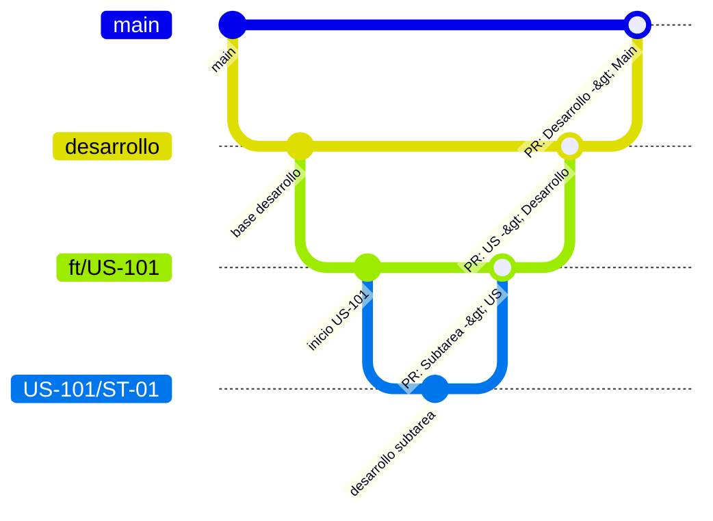

# DonaKit - Backend

Servidor backend para el proyecto **DonaKit**, desarrollado con [NestJS](https://nestjs.com/) y TypeScript.

---

## 📌 Versiones Exactas del Entorno

Para asegurar que todo el equipo trabaje en el mismo entorno y evitar inconsistencias (*"en mi máquina sí funciona"*), se definen las siguientes versiones oficiales:

| Herramienta / Paquete | Versión Exacta / Instalada |
| :--- | :--- |
| **Node.js** | `v24.21.0` (definida en `.nvmrc`) |
| **npm** | `v11.19.0` |
| **NestJS Core / Common** | `v12.0.1` |
| **NestJS CLI** | `v12.0.0` |
| **TypeScript** | `v6.0.2` |
| **Vitest** (Testing) | `v4.1.2` |
| **Oxlint** (Linter) | `v1.58.0` |
| **Prettier** | `v3.4.2` |

> 💡 **¿Es necesario Docker para compartir las mismas versiones?**  
> **No es obligatorio en esta etapa.** El archivo `package-lock.json` ya congela el árbol completo de dependencias. Al ejecutar `npm ci` (en lugar de `npm install`), npm garantiza que todos los integrantes del equipo descarguen **exactamente los mismos paquetes y subdependencias**.  
> Para Node.js, si utilizas un gestor como `nvm` o `fnm`, basta con ejecutar `nvm use` en la raíz del proyecto para sincronizar la versión de Node.  
> *(Docker se recomienda únicamente si más adelante se integran bases de datos locales como PostgreSQL/MySQL o servicios externos).*

---

## 📦 Instalación de Dependencias

1. Navega hasta el directorio del backend:
   ```bash
   cd donakit-backend
   ```

2. Sincroniza la versión de Node (si usas `nvm` o `fnm`):
   ```bash
   nvm use
   ```

3. Instala **exactamente** las versiones congeladas en `package-lock.json`:
   ```bash
   npm ci
   ```
   *(Nota: `npm ci` es la mejor práctica para equipos, ya que no modifica el lockfile y asegura paridad total).*

---

## ⚙️ Configuración del Entorno y Puertos

El servidor escucha por defecto en el puerto **3000** (`process.env.PORT ?? 3000`).

Si corres el backend junto con el frontend y deseas asignar un puerto específico:
- **Windows (PowerShell):**
  ```powershell
  $env:PORT="3000"; npm run start:dev
  ```
- **Windows (CMD):**
  ```cmd
  set PORT=3000 && npm run start:dev
  ```
- **Linux / macOS:**
  ```bash
  PORT=3000 npm run start:dev
  ```

---

## 🚀 Ejecución del Proyecto

### Modo Desarrollo (con recarga automática / watch)
```bash
npm run start:dev
```

### Modo Estándar
```bash
npm run start
```

### Modo Debug
```bash
npm run start:debug
```

### Modo Producción
```bash
# 1. Compilar el proyecto a JavaScript (genera la carpeta dist/)
npm run build

# 2. Iniciar el servidor compilado
npm run start:prod
```

El servidor responderá en: `http://localhost:3000` (o el puerto configurado).

---

## 🧪 Pruebas y Calidad de Código

```bash
# Pruebas unitarias
npm run test

# Pruebas unitarias en modo interactivo (watch)
npm run test:watch

# Reporte de cobertura de código
npm run test:cov

# Pruebas End-to-End (E2E)
npm run test:e2e

# Análisis de código con Oxlint
npm run lint

# Formateo automático de código con Prettier
npm run format
```

---

## 🤖 Skills y Asistentes de IA para el Equipo

El repositorio incluye directrices y skills compartidas para el equipo:
- **Skill de NestJS en el repositorio**: Ubicada en `.agents/skills/nestjs/SKILL.md`. Al estar guardada en Git dentro del repositorio, cualquier miembro que utilice **Antigravity IDE** o **Gemini CLI** tiene acceso a esta skill automáticamente sin necesidad de instalaciones manuales.
- **CLI de Nest**: Viene instalada localmente como dependencia de desarrollo (`@nestjs/cli v12.0.0`), por lo que cualquier comando puede ejecutarse con:
  ```bash
  npx nest --help
  ```

---

## 🌿 Flujo de Trabajo con Git (Branching & PRs)

Para mantener el orden y la calidad del código, el equipo sigue una estrategia de ramificación jerárquica estricta:

### 1. Jerarquía y Nomenclatura de Ramas

| Nivel | Tipo de Rama | Origen (*Branch off*) | Nomenclatura | Ejemplo | Descripción |
| :---: | :--- | :--- | :--- | :--- | :--- |
| **1** | Producción | - | `main` | `main` | Código estable y desplegable. |
| **2** | Desarrollo | `main` | `desarrollo` | `desarrollo` | Rama base de integración activa del equipo. |
| **3** | Historia de Usuario | `desarrollo` | `ft/US-XXX` | `ft/US-101` | Funcionalidad o historia de usuario completa. |
| **4** | Subtarea | `ft/US-XXX` | `US-XXX/ST-XX` | `US-101/ST-01` | Tarea técnica puntual dentro de la US. |



### 2. Orden Jerárquico Obligatorio de Pull Requests (PRs)

Los PRs **siempre deben fusionarse en orden ascendente**, sin saltar niveles:

1. **Subtarea ➔ Historia de Usuario (`US-XXX/ST-XX` ➔ `ft/US-XXX`):**  
   Al culminar la subtarea, se crea un PR con destino a la rama de su User Story.
   ```bash
   # Crear la rama de subtarea partiendo de la US
   git checkout ft/US-XXX
   git pull origin ft/US-XXX
   git checkout -b US-XXX/ST-XX
   ```
2. **Historia de Usuario ➔ Desarrollo (`ft/US-XXX` ➔ `desarrollo`):**  
   Cuando todas las subtareas estén aprobadas y fusionadas en la US, se crea un PR desde `ft/US-XXX` hacia `desarrollo`.
   ```bash
   # Crear la rama de US partiendo de desarrollo
   git checkout desarrollo
   git pull origin desarrollo
   git checkout -b ft/US-XXX
   ```
3. **Desarrollo ➔ Main (`desarrollo` ➔ `main`):**  
   Al cierre del sprint o ciclo de entrega, una vez validadas todas las funcionalidades integradas, se genera el PR hacia `main`.

> ⚠️ **Regla importante:** Las ramas de subtareas (`US-XXX/ST-XX`) **nunca** se abren desde `desarrollo` ni se envían en PR directo a `desarrollo` o `main`. Siempre se integran primero a su rama `ft/US-XXX`.

---

## 🏗️ Arquitectura y Mejores Prácticas del Backend

En NestJS, la mejor práctica oficial es la **Arquitectura Modular por Dominio/Características (`src/modules/<dominio>/`)**, en lugar de agrupar todos los controladores o servicios del sistema en carpetas globales planas.

Cada funcionalidad de negocio se organiza como un módulo autónomo que encapsula sus propios **Controllers**, **Services**, **Repositories**, **DTOs** y **Entities**:

### 📂 Estructura Modular de Carpetas

```text
donakit-backend/
├── src/
│   ├── modules/                     # Módulos de funcionalidad / dominio de negocio
│   │   ├── auth/                    # Módulo de Autenticación
│   │   │   ├── auth.module.ts       # Declaración del módulo (@Module)
│   │   │   ├── auth.controller.ts   # Endpoints de autenticación (login, registro, refresh)
│   │   │   ├── auth.service.ts      # Lógica de emisión y verificación de tokens/credenciales
│   │   │   ├── strategies/          # Estrategias Passport (jwt.strategy.ts, local.strategy.ts)
│   │   │   └── dto/                 # DTOs de validación (login.dto.ts, register.dto.ts)
│   │   │
│   │   └── donations/               # Ejemplo de módulo de dominio (donaciones, usuarios, etc.)
│   │       ├── donations.module.ts
│   │       ├── donations.controller.ts  # Capa de entrada HTTP (Rutas, Swagger, códigos HTTP)
│   │       ├── donations.service.ts     # Capa de lógica de negocio pura
│   │       ├── donations.repository.ts  # Capa de acceso a datos (Patrón Repository)
│   │       ├── dto/                     # Data Transfer Objects validados con class-validator
│   │       │   ├── create-donation.dto.ts
│   │       │   └── update-donation.dto.ts
│   │       ├── entities/                # Entidad de persistencia (BD / ORM)
│   │       │   └── donation.entity.ts
│   │       └── interfaces/              # Contratos e interfaces TypeScript del módulo
│   │
│   ├── common/                      # Capa transversal compartida (Cross-Cutting Concerns)
│   │   ├── guards/                  # Guardias de autorización y seguridad (jwt-auth.guard.ts, roles.guard.ts)
│   │   ├── interceptors/            # Interceptores (logging de peticiones, formateo uniforme de respuestas)
│   │   ├── filters/                 # Filtros globales de captura de excepciones (http-exception.filter.ts)
│   │   ├── pipes/                   # Pipes de validación y transformación de datos (validation.pipe.ts)
│   │   └── decorators/              # Decoradores personalizados (@CurrentUser, @Public, @Roles)
│   │
│   ├── config/                      # Configuración centralizada del sistema y variables de entorno
│   │   ├── configuration.ts         # Mapeo tipado de variables (.env)
│   │   └── env.validation.ts        # Validación de variables de entorno al iniciar la app
│   │
│   ├── database/                    # Conexión a la base de datos, migraciones y seeders
│   ├── app.module.ts                # Módulo raíz que importa y orquesta todos los módulos
│   └── main.ts                      # Punto de entrada (bootstrap de NestJS, CORS, Swagger, prefijo global /api)
│
├── test/                            # Pruebas End-to-End (E2E) con Vitest
├── nest-cli.json                    # Configuración del CLI de Nest
├── tsconfig.json                    # Configuración de TypeScript
└── package.json                     # Dependencias y scripts
```

### 🎯 Responsabilidad de cada Capa en NestJS

| Capa | Ubicación típica | Responsabilidad |
| :--- | :--- | :--- |
| **Controllers** | `*.controller.ts` | Recibir la petición HTTP, validar el DTO de entrada y retornar el código de estado HTTP adecuado. **No debe contener lógica de negocio**. |
| **Services** | `*.service.ts` | Contener las reglas de negocio, validaciones lógicas y coordinar el flujo de datos. Anotados con `@Injectable()`. |
| **Repositories** | `*.repository.ts` | Encapsular las consultas y operaciones con la base de datos (patrón Repository), desacoplando el ORM de la lógica de negocio. |
| **DTOs** | `dto/*.dto.ts` | Clases que definen la forma de los datos recibidos con decoradores de `class-validator` para tipado y validación estricta en tiempo de ejecución. |
| **Entities** | `entities/*.entity.ts` | Modelos de persistencia que representan las tablas/colecciones en la base de datos. |
| **Guards** | `common/guards/` | Controlar el acceso a rutas mediante autenticación (JWT) y roles/permisos. |
| **Interceptors** | `common/interceptors/` | Añadir lógica antes/después de la ejecución del método (transformar respuestas, registrar tiempos de respuesta). |
| **Filters** | `common/filters/` | Atrapar errores y excepciones para devolver un JSON de error uniforme al cliente. |
| **Pipes** | `common/pipes/` | Transformar o validar parámetros antes de llegar al controlador. |
```
